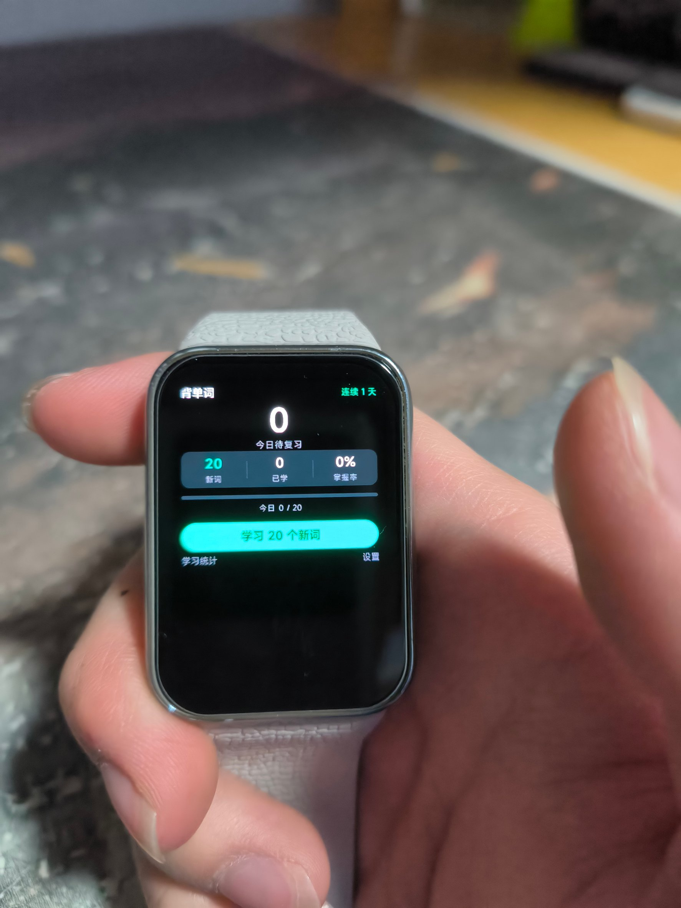

# 背单词 · 小米手环 8 Pro（Xiaomi Vela 快应用）

给小米手环 8 Pro 写的记单词应用，基于 **Xiaomi Vela / HyperOS 快应用**（不是 Android 应用，装不了 APK —— 手环跑的是 Vela 系统）。

- 词库：高考 3500 词（3851 条，含少量常用短语），带音标（字母近似记法）、词性、中文释义
- 每天新词量：10 / 15 / 20 / 30 / 50 自选
- 复习：SM-2 记忆曲线变体，按到期日每天自动算出要复习的单词
- 屏幕：按 336 × 480 设计（手环 8 Pro 的矩形屏）

安装包：`dist/com.dsh.bandwords.debug.1.0.9.rpk`



### 更新日志

- **1.0.9**（当前）—— 修图标占四格
  - 手环启动器按图标**自身像素尺寸**摆放，之前 `logo.png` 是 192×192，于是占了 2×2 = 四格。参考在售手环应用（miSmash、HyperSchedule-for-Band）的图标都是 96×96，改成 96
  - 顺手重画：整块绿色圆底 + 白色 A，跟启动器里其它应用「彩色圆 + 白色字形」风格一致，小尺寸下比原来的「深底绿 A」清楚
  - `tools/make-icon.py` 改为 96×96、8 倍超采样抗锯齿，参数都在文件头
- **1.0.8**—— 修「点返回首页后学习进度没记上」
  - 根因 1：首页每次回到前台都会先 `flush` 再重读，可它内存里是**上一次读到的旧进度**，这一写就把学习页刚存的新进度盖掉了。现在 `reload()` 只丢内存副本重读，绝不写盘
  - 根因 2：评分原来是 600ms 防抖落盘，中途退出页面写入可能还在路上。现在评分、改设置都**立即落盘**（分片是增量的，一次评分只写 1 个分片）
  - 点「返回首页 / 退出」会等这一轮写盘回调再返回，另有 400ms 兜底防止卡住
- **1.0.7**
  - 完成页只保留一颗「返回首页」按钮，去掉「继续学习」「今日复习」（这两个入口在首页已经有了）
  - 顺手清掉只服务这两个按钮的 `prepareNext` / `extendLearning` 和三个样式，学习页少一段无用代码
- **1.0.6**—— 只做性能和体积优化，功能与数据格式不变
  - 词表从「嵌套数组字面量」改成「每行一条、`|` 分隔的字符串」：Babel 会把数组逐项缩进展开，215KB 数据在产物里涨到 ~900KB，现在原样 112KB，学习页第一次用到时才拆行
  - 词表只进学习页。以前 `store.js` 引用词表，而每个页面都引用 `store.js`，于是 5 个页面各带一份；现在 `store.js` 只用 `wordmeta.js` 里的总数（3851），只有学习页 `require("wordlist.js")`
  - 启动改成并发读：设置 / 入口意图 / 进度元信息三个 key 同时读，分片读到 4 路并发
  - 写盘改成增量：只写内容变过的分片、`meta` 没变就不写。评分一个词从「整份进度重写（最多 26 次写）」降到 1~2 次写
  - 包体 **526 KB → 130 KB**（-75%），首页/设置/统计页脚本 **约 1 MB → 60~75 KB**，学习页 1 MB → 273 KB；冷启动不再解析几十万个数组元素
- **1.0.5**
  - 音标全部改成 ASCII 字母近似记法：手环系统字体没有国际音标扩展字形，`ʃ θ ð ŋ ɪ ə ː ˈ ˌ` 这些会显示成空白或方框；现在 `ʃ→sh`、`θ→th`、`tʃ→ch`、`ŋ→ng`、`ˈ→'`、`ː→:`，`/ˈæpl/` 显示为 `/'ap(e)l/`，任何字体都画得出来
  - 学习卡片只显示第一个读音，过长时再砍掉英美异读，保证 336px 宽一行放得下（最长 22 字符）
  - 修补源词表 3 条串行数据：`sofa` 的音标混进了 `socket`、释义混进了 `soft`（`soft` 词条整个丢了，已补回）、`sort` 释义里有多余的 `]`
- **1.0.4**
  - 首页也加上「继续学习」「今日复习」两个按钮：关机重开、退出应用再进来，都能直接从首页接着学 / 复习今天学过的词，不用先走一遍完整流程
  - 首页「继续学习」是智能的：今天还有没学完的就显示「还剩 N 词」并直接继续；已经学完了就显示「+N 词」，点一下再追加一批新词
  - 首页「今日复习」显示今天的词数（如「20 词」），点一下直接进学习页的今日复习模式，和普通复习分开
  - 首页布局重新压缩（数字 72→62、统计卡 84→76、按钮 66→60），新增一行按钮后仍然一屏放得下
  - 进入学习页的意图（日常 / 今日复习）用一次性标记 `bw_sess` 传递：首页写入、学习页读完即清，避免残留导致下次误进今日复习
- **1.0.3**
  - 修「退出学习页后首页不刷新」：快应用按页面打包，`require("common/store.js")` 在每个页面里其实是**各自一份实例**（rpk 里 pages/index/index.js、pages/study/study.js、app.js 各内联了一份 store 代码），学习页评分只改了它自己那份内存数据，首页那份要到下次启动重新读存储才更新。现在 store 加了 `reload()`，首页 / 统计 / 设置页的 `onShow` 都先重新从本地存储读一遍再刷新
  - 完成页新增两个入口：**继续学习**（往今日计划里再追加一批新词，接着学）和 **今日复习**（只过今天新学过的词，随机顺序，和普通复习分开）
  - 今日复习不干扰原有排期：答「认识 / 模糊」不改间隔和到期日（同一天重复复习不该算掌握加深），只有「忘记」才把词打回重学、明天再来
  - 图标再缩小一圈：圆形底半径 84，A 只占中间约 40%，描边也更细
- **1.0.2**
  - 修屏幕缩放：`manifest.json` 的 `designWidth` 从 `"device-width"` 改成 `336`。原来 `"device-width"` 被运行时当成默认 480 处理，整页被缩到 0.7 倍、内容只占屏幕上半截（真机反馈 1）
  - 修设置页空白：原来把 `for` 直接写在带 `class` 绑定的 `div` 上，渲染到那一行就中断，后面整页不显示（真机反馈 2）。改成 Vela 标准的 `<block for="…">` 包裹，并且设置页去掉 `scroll`、选项高亮改成预计算 class，整页一屏放得下
  - 修图标过大：重画 `src/common/logo.png`，圆形底 + 留边距的小号 A，不再被应用列表的圆形蒙版裁掉（真机反馈 3）
  - 顺手修进度条：进度容器改 `flex-direction: row`，`width: X%` 才会真正生效（原来在 column 容器里被拉伸成满格）
- **1.0.0 / 1.0.1**：首版 + block 循环修复

---

## 一、界面预览

`preview/preview.html` 是同一套界面在浏览器里的复刻（用的是真实的页面模板 + 真实的调度逻辑 + 真实词库），不用手环也能先看效果、点着玩：

```bash
cd bandwords/preview
python3 -m http.server 8099          # 然后手机/电脑浏览器打开 http://127.0.0.1:8099/preview.html
```

预览页里四个页面可以互相跳转，学习流程（翻面 → 忘记/模糊/认识）都是真的在跑调度算法，数据存在浏览器 localStorage 里，右下角「清空预览数据」可重置。

## 二、安装到手环

手环没有应用商店入口给第三方应用，社区通用的办法是用 **AstroBox**（免费、非官方）通过蓝牙把 `.rpk` 装进去。手环 8 Pro 在 AstroBox 的支持列表里。

### 准备

1. 手环已经和手机上的「小米运动健康」配对登录
2. 手机装 AstroBox：<https://astrobox.online>（安卓 APK）
3. 安装包：`dist/com.dsh.bandwords.debug.1.0.9.rpk`

（**先把它传到手机上**）

### 步骤

1. **关掉小米运动健康**：设置 → 应用 → 小米运动健康 → 强行停止（手环同时只能连一个）
2. **AstroBox 登录小米账号**：设置 → 更多设置 → 小米账号，用和小米运动健康同一个账号
3. **手环上**：设置 → 连接新手机 → 打勾确认，停在这个等待界面
4. **AstroBox 打开设备列表**，选中你的手环，手机和手环两边都确认配对
5. **装应用**：把 `.rpk` 文件拖进 AstroBox，或在设备页选 **快应用 / Quick app → +**，选中这个 rpk
6. 手环应用列表里会出现「背单词」，打开即用
7. 装完回到手机，重新打开小米运动健康，让它恢复同步

### 如果 AstroBox 找不到手环

账号注册地在国内一般能直接导入设备；海外账号可能设备列表为空（AstroBox 只查国内服务器）。这时用 **Authkey** 直连：

1. 手机打开 USB 调试（设置 → 关于手机 → 连点版本号 7 次 → 开发者选项 → USB 调试）
2. 电脑装 adb，手机连电脑，`adb devices` 能看到设备
3. 从小米运动健康日志里取 32 位 key：
   ```bash
   adb shell 'cat /sdcard/Android/data/com.xiaomi.wearable/files/log/*.log* | grep -oE "(encryptKey|authKey|token)[\":= ]+[[:xdigit:]]{32}" | grep -oE "[[:xdigit:]]{32}$" | sort | uniq -c'
   ```
4. AstroBox 退出小米账号 → 手环再进「连接新手机」→ 设备列表里选设备、粘贴 Authkey → 连接 → 继续上面的第 5 步

> 部分 HyperOS 手环固件还有一条官方 Debug 通道：小米运动健康 → 我的 → 关于 → 连点「关于」进 Debug → 第三方应用 → 输入包名 `com.dsh.bandwords` → Install third app → 选本地 rpk。能不能用取决于固件版本，没有的话就用 AstroBox。

### 卸载 / 更新

- 更新：用新 rpk 直接覆盖安装，不用先卸载（versionCode 要更大）
- 卸载：手环应用列表里通常没有卸载项，去 AstroBox 设备页的快应用里删

## 三、怎么用

| 页面 | 说明 |
| --- | --- |
| 首页 | 今日待复习数、今天的新词数、已学与掌握率、词库进度；中间大按钮开始/继续当日计划；下面一行两个快捷入口：**继续学习**（有剩余就继续，学完了就再追加一批）和 **今日复习**（只复习今天新学的词） |
| 学习 | 先复习到期旧词，再学新词；卡片轻点翻面看释义；三档评分「忘记 / 模糊 / 认识」；忘记的词会在 4 张卡后重来一次；全部过完显示今日完成 |
| 完成页 | 今日完成数、新词 / 复习 / 需要加强的数量；只有一颗「返回首页」按钮（继续学习、今日复习回首页点） |
| 统计 | 已学 / 已掌握 / 连续天数 / 累计天数 + 未来 7 天每天要复习多少（柱状图）|
| 设置 | 每天新词数、每日复习上限、新词顺序（按字母 / 乱序）、清空学习进度（连点两次确认）|

## 四、记忆算法

`src/common/store.js` 里是 SM-2 的简化变体，每条进度记 `{r, i, d, e, t}`：

- `r` 连续答对次数，`i` 当前间隔（天），`d` 下次到期日（本地日序号），`e` 难易因子（130 ~ 300，默认 250）
- **认识**：第一次间隔 1 天，第二次 3 天，之后 `i = round(i × e / 100)`（1 → 3 → 8 → 21 → 55 …）；`e += 5`
- **模糊**：`i = max(1, round(i × 1.2))`；`e -= 8`
- **忘记**：`r` 归 1，`i` 归 1，明天重来；`e -= 25`（不低于 130）
- 连续答对使 `i ≥ 21` 天视为「已掌握」
- **今日复习**（`gradeTodayReview`）是另一套规则：只针对当天新学的词，答「认识 / 模糊」不动 `i` / `d`（避免同一天重复复习被当成两次成功而把间隔推太远），答「忘记」则 `r=1, i=1`、明天重来
- 每天首次打开时生成当天计划：所有 `d <= 今天` 的词按到期日先后排，再按设置取 N 个没学过的新词；复习量受「每日复习上限」约束，避免某天爆量
- 连续天数：当天有过学习行为就 +1，断一天归 1

进度按 3000 字符一片分片存在 `@system.storage` 里，写入做了 600ms 防抖、且只写变过的分片，手环重启不丢数据。

## 五、自己改

```bash
cd bandwords
npm install          # 首次（aiot-toolkit 依赖较多，约 370MB）
npm run build        # 产出 dist/com.dsh.bandwords.debug.<version>.rpk
```

- **加词/改词**：`src/common/worddata.js`（每行一条、字段用 `|` 分隔：单词、音标、释义、其他形式），改完跑 `node tools/wordfile.js` 重新打包并同步 `wordmeta.js` 的总数。词表来自公开的 <https://github.com/pluto0x0/word3500>，已做连字符、并列写法（`grey / gray`）、专有名词星号等清洗
- **改屏幕尺寸**：所有页面按 336 × 480 硬编码（`.page` 高度 100%，单位是 px，`designWidth: device-width` 即 1px = 1 物理像素）。其它尺寸手环（如 192 × 490 的非 Pro）需要调 `src/pages/*/*.ux` 里的字号和高度
- **改界面**：`src/pages/<页面>/<页面>.ux`，`<template>` 写结构、`<script>` 写数据与方法、`<style>` 只允许 class 选择器
- **改算法参数**：`src/common/store.js` 顶部常量（`EF_DEFAULT`、`EF_MIN`、`EF_MAX`、`MASTER_DAYS`）

## 六、体积与性能

| 指标 | 1.0.5 | 1.0.6 |
| --- | --- | --- |
| 安装包 | 526 KB | **130 KB** |
| 首页脚本 | 1 004 KB | **75 KB** |
| 设置页脚本 | 994 KB | **65 KB** |
| 统计页脚本 | 991 KB | **61 KB** |
| app 级脚本 | 965 KB | **35 KB** |
| 学习页脚本 | 1 010 KB | **273 KB**（几乎全是 3851 条词条本身） |

做法：词表只进学习页、词表存成字符串而不是数组字面量、启动并发读、写盘只写变化的分片。数据和交互没有任何删减。

## 七、自测

```bash
node test/store.test.js     # 78 项：词库质量、SM-2 间隔、跨天复习、今日复习、上限、分片持久化、增量写盘
node test/ux-lint.js        # 模板字段/事件/组件白名单/CSS 选择器静态检查
node test/preview.test.js   # jsdom 跑真实页面：首页 → 学习 → 评分 → 完成页 → 继续学习 → 今日复习 → 设置 → 统计（60 项）
```

`test/preview.test.js` 需要 jsdom（`npm i -D jsdom`）。

## 八、已知限制

- 这版 rpk 是 **debug 签名**（aiot-toolkit 自带证书），和社区其它手环快应用一样靠 AstroBox 侧载；商店上架需要小米开放平台的正式签名
- 词库 3851 条里包含 `a can opener` 这类短语，个别条目沿用原词表的瑕疵（例如少数派生词拼写不规范），介意可以自己删
- 没有发音（Vela 上取音频资源麻烦），音标是文本；音标用 ASCII 近似记法而不是标准国际音标，原因见下面的对照表
- 界面只针对 8 Pro 的 336 × 480 调过（`designWidth: 336`，1 CSS px = 1 物理 px），圆屏手表上会错位
- 改尺寸时注意：所有 px 都是物理像素，`designWidth` 必须等于屏宽，否则整页会等比缩放
